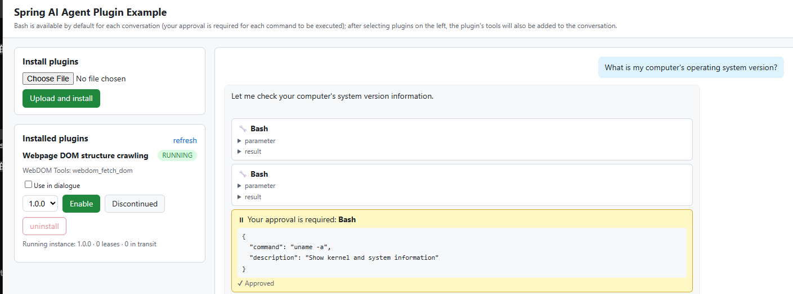
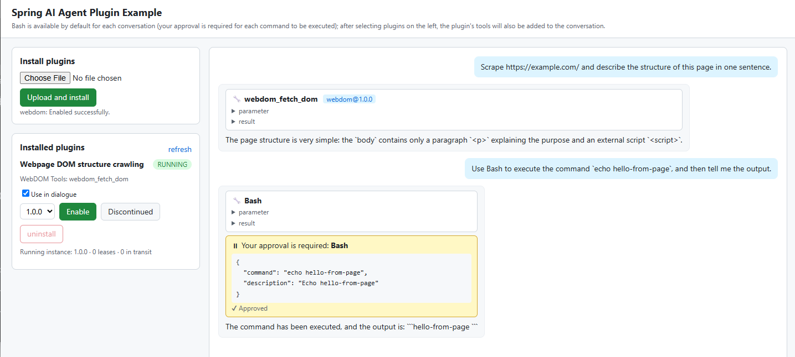

**English** | [简体中文](README.zh-CN.md)

# Spring AI Agent Plugin System Demo

Companion code for the article "用 Java + Spring AI 构建 Agent 插件系统" ("Building an Agent Plugin System with Java and
Spring AI", written in Chinese): a minimal but complete Spring AI agent that can install, upgrade, and uninstall Java
plugins at runtime.

**1. The built-in Bash tool, with human approval.** No plugin is selected here: the model decides to run `uname -a`, and the
call waits until a human approves it.



**2. A custom plugin: the web-crawler tool.** After the `webdom` plugin JAR is uploaded and enabled, its `webdom_fetch_dom`
tool joins the conversation next to Bash. Bash calls still need approval.



*Both screenshots show the bundled web page (`http://localhost:8080/`). The page itself is in Chinese; the screenshots show it
translated into English.*

- **Load plugins without a restart**: uploading a JAR installs it (no plugin code runs at install time), and the plugin is
  loaded only when you enable it. An upgrade starts the new version first and then switches over; conversations already in
  progress keep using the old version.
- **Streaming chat**: `POST /chat/stream` returns SSE. Every conversation gets a Bash tool by default (`ShellTools` from
  Agent Utils), and the tools of the plugins listed in the request are handed to Spring AI's official tool-calling loop
  along with it.
- **Human approval**: every Bash call must be approved (Spring AI's official `spring.ai.tools.confirmation.tools` setting),
  and plugin tools can be made to require approval by their manifest or by an administrator. Approval requests are pushed
  to the client over SSE, and the decision is sent back with `POST /approvals/{id}`.
- **Reclaimable plugins**: each plugin version gets its own classloader (parent-first). Once a plugin is disabled, the old
  version retires and its classloader can be garbage-collected (a test proves it).
- **A simple web page**: open `http://localhost:8080/` to install, enable, upgrade, disable, and uninstall plugins, chat with
  streamed replies, and approve or deny tool calls, all without curl.

## Requirements

- JDK 25 and Maven 3.9+
- An API key for DeepSeek or a compatible endpoint. By default the app uses DeepSeek on Volcengine Ark (火山方舟). To use the
  official DeepSeek API instead, set `DEEPSEEK_BASE_URL=https://api.deepseek.com` and `DEEPSEEK_MODEL=deepseek-chat`.

## Project Structure

```text
spring-ai-hotplug-demo/
├── pom.xml                          Aggregator and parent POM: Spring Boot 4.1.0, Spring AI 2.1.0-RC1, Java 25
├── plugin-api/                      Plugin contract agent-plugin-api: the AgentPlugin and PluginContext interfaces, no dependencies
├── app/                             Host agent-app: Spring Boot + Spring AI + Agent Utils
│   ├── src/main/java/com/example/agent/
│   │   ├── plugin/                  Plugin runtime: manifest, store, installer, classloader, runtime instance, manager, lease, tool wrapper, approval policy, admin API
│   │   └── chat/                    Streaming chat: ChatController, event stream ChatEvents, approvals (InteractiveToolCallingManager / ApprovalRegistry)
│   └── src/main/resources/static/index.html   Web page for managing plugins and chatting (one file of plain HTML, CSS, and JavaScript; no build step)
├── plugin-sample/web-dom-crawler/   Sample plugin webdom: fetches a web page and returns its DOM outline; jsoup is relocated via shade
└── classloader-lab/                 Hands-on classloading experiments (not a Maven module; run directly with javac/java)
```

## Build and Test

```bash
mvn package
```

This compiles the three modules, runs all the tests, and produces:

- `app/target/agent-app-1.0.0-SNAPSHOT.jar`: the host (an executable Spring Boot JAR);
- `plugin-sample/web-dom-crawler/target/web-dom-crawler-plugin-1.0.0.jar`: the plugin to upload (the shaded JAR, not
  `original-*.jar`).

`ChatStreamLiveTest` runs a complete streaming conversation against a real model (plugin tool, Bash that needs approval, SSE
events, lease release). It only runs when `DEEPSEEK_API_KEY` is set and is skipped otherwise:

```bash
DEEPSEEK_API_KEY=your-api-key mvn test -pl app -am -Dtest=ChatStreamLiveTest
```

## Run

Start from the repository root (plugin data goes to `./data/plugins` by default, and Bash's working directory defaults to
`./data/workspace`):

```bash
DEEPSEEK_API_KEY=your-api-key java -jar app/target/agent-app-1.0.0-SNAPSHOT.jar
```

> On Windows cmd, set the variable first with `set DEEPSEEK_API_KEY=your-api-key`. Without a key the app still starts and you
> can try the plugin management API; only chat will fail.

## Try It Out

### With the web page

Open `http://localhost:8080/`. The left column installs and manages plugins; the right column is the chat.

1. Under **安装插件** (Install plugin), choose the shaded JAR and click **上传并安装** (Upload and install). The plugin appears
   in the list as `DISABLED`.
2. Click **启用** (Enable). It becomes `RUNNING`; tick **在对话中使用** (Use in conversation) so that its tools are added to
   your chats. The line under the chat box lists the tools the next message can use: Bash, plus every ticked plugin.
3. Type a message and press Enter (Shift + Enter inserts a line break). The reply streams in. Each tool call is a card that
   shows its arguments and result, with a tag for the plugin version that ran it.
4. A call that needs approval (Bash always does) shows a yellow card with **批准** (Approve) and **拒绝** (Deny). Pressing
   **停止** (Stop) ends the conversation and withdraws any approval nobody has answered, so the tool never runs.
5. To upgrade, upload the new version, pick it in the version dropdown, and click **启用**. If a conversation is still using
   the old version, the runtime line shows both instances (`1.0.0 RETIRING · 租约 1`, where 租约 means lease) until it ends.
   **停用** (Disable) and **卸载** (Uninstall) work the same way.

The page is a single static file that calls the API below, so everything it does can also be done with curl.

### With curl

Run the commands below from the repository root; the service listens on `localhost:8080`.

> On Windows Git Bash, `curl -d` with non-ASCII text (such as Chinese) may send non-UTF-8 bytes, and the server answers 400.
> Save the request body to a UTF-8 file and send it with `--data-binary @body.json` instead.

**1. Install the plugin** (it is only validated and saved, and no plugin code runs; uploading the same JAR again returns 200):

```bash
curl -X POST http://localhost:8080/admin/plugins \
  -F "file=@plugin-sample/web-dom-crawler/target/web-dom-crawler-plugin-1.0.0.jar"
```

**2. Change the configuration and enable the plugin** (the configuration takes effect the next time the plugin starts):

```bash
curl -X PUT http://localhost:8080/admin/plugins/webdom/config \
  -H "Content-Type: application/json" -d '{"values": {"timeoutSeconds": "20"}, "confirmTools": []}'

curl -X POST http://localhost:8080/admin/plugins/webdom/enable \
  -H "Content-Type: application/json" -d '{"version": "1.0.0"}'
```

**3. Use the plugin in a conversation**:

```bash
curl -N -X POST http://localhost:8080/chat/stream \
  -H "Content-Type: application/json" \
  -d '{"message": "Fetch https://example.com/ and describe the structure of the page in one sentence.", "plugins": ["webdom"]}'
```

Excerpt of the output (blank lines between events omitted; the wording of the reply will differ):

```text
data:{"type":"tool_call","id":"call_xr7v…","tool":"webdom_fetch_dom","plugin":"webdom@1.0.0","arguments":"{\"url\": \"https://example.com/\"}"}
data:{"type":"tool_result","id":"call_xr7v…","tool":"webdom_fetch_dom","plugin":"webdom@1.0.0","text":"\"URL: https://example.com/\\nStatus: 200\\nTitle: Example Domain\\n…"}
data:{"type":"token","text":"The"}
data:{"type":"token","text":" page"}
……
data:{"type":"finish"}
```

**4. Ask the model to run Bash, which needs your approval**:

```bash
curl -N -X POST http://localhost:8080/chat/stream \
  -H "Content-Type: application/json" \
  -d '{"message": "Use Bash to run the command echo hello-from-bash, then tell me the output."}'
```

The stream stops at an approval request:

```text
data:{"type":"tool_call","id":"call_ozlq…","tool":"Bash","arguments":"{\"command\": \"echo hello-from-bash\", …}"}
data:{"type":"approval_request","id":"fd75ee8d-311d-426d-86f6-dffe7aa8ce1b","tool":"Bash","arguments":"{\"command\": \"echo hello-from-bash\", …}"}
```

In another terminal, list the pending approvals and approve this one (with `"approve": false` the request is denied: the tool
does not run, and the model will tell you so):

```bash
curl http://localhost:8080/approvals
curl -X POST http://localhost:8080/approvals/fd75ee8d-311d-426d-86f6-dffe7aa8ce1b \
  -H "Content-Type: application/json" -d '{"approve": true}'
```

**5. Zero-downtime upgrade**: change the plugin's own `<version>1.0.0</version>` in
`plugin-sample/web-dom-crawler/pom.xml` to `1.1.0`, then rebuild, install, and enable it:

```bash
mvn -pl plugin-sample/web-dom-crawler -am package -DskipTests
curl -X POST http://localhost:8080/admin/plugins \
  -F "file=@plugin-sample/web-dom-crawler/target/web-dom-crawler-plugin-1.1.0.jar"
curl -X POST http://localhost:8080/admin/plugins/webdom/enable \
  -H "Content-Type: application/json" -d '{"version": "1.1.0"}'
```

If a conversation is still using 1.0.0 when you switch (for example, it is waiting for approval), the plugin details show
both instances at once; the old version stops automatically after it has finished serving that conversation:

```json
"runtimes": [
  {"version": "1.1.0", "state": "RUNNING", "leases": 0, "inFlight": 0, "startedAt": "…"},
  {"version": "1.0.0", "state": "RETIRING", "leases": 1, "inFlight": 0, "startedAt": "…"}
]
```

**6. Disable and uninstall**:

```bash
curl -X POST http://localhost:8080/admin/plugins/webdom/disable
curl -X DELETE "http://localhost:8080/admin/plugins/webdom?purgeData=true"
```

Once the plugin is disabled, a chat request that names it is rejected with 400 before the SSE stream is established:
`{"code":"invalid_request","message":"Plugin webdom is not running (DISABLED)"}`.

## API Overview

| Method | Path | Description |
| --- | --- | --- |
| GET | `/` | The web page |
| POST | `/chat/stream` | Streaming chat (SSE). Request body: `{"message", "plugins"?, "userId"?, "sessionId"?}` |
| GET | `/approvals` | Tool calls waiting for approval |
| POST | `/approvals/{id}` | Approve or deny: `{"approve": true}`; 200 means the decision was delivered, 404 means the request timed out, was already decided, or the ID is wrong |
| POST | `/admin/plugins` | Upload and install (multipart: `file`, optional `sha256`); 201 for a new version, 200 for the same version |
| GET | `/admin/plugins`, `/admin/plugins/{id}` | Plugin list, plugin details (state, versions, tools, configuration, runtime instances) |
| POST | `/admin/plugins/{id}/enable` | Enable or switch versions: `{"version": "1.0.0"}`; rollback uses it too |
| POST | `/admin/plugins/{id}/reload` | Restart the enabled version with the current configuration |
| POST | `/admin/plugins/{id}/disable` | Disable |
| PUT | `/admin/plugins/{id}/config` | Replace the configuration values and the extra approval list as a whole: `{"values": {...}, "confirmTools": [...]}` |
| DELETE | `/admin/plugins/{id}?purgeData=false` | Uninstall a disabled plugin |

SSE events: `token` (model text), `tool_call`, `approval_request` (`id` is the approval ID), `tool_result`, `heartbeat` (safe to
ignore), `finish`, and `error`. The `plugin` field is the plugin version that actually executed the call; tools built into the
host have no such field. Error responses always have the shape `{"code","message"}`.

## Configuration

| Property | Environment variable | Default | Description |
| --- | --- | --- | --- |
| `spring.ai.deepseek.api-key` | `DEEPSEEK_API_KEY` | placeholder value | Model API key |
| `spring.ai.deepseek.base-url` | `DEEPSEEK_BASE_URL` | Volcengine Ark | Model endpoint URL |
| `spring.ai.deepseek.chat.model` | `DEEPSEEK_MODEL` | `deepseek-v4-flash-ga-260731` | Model name |
| `spring.ai.tools.confirmation.tools` | | `[Bash]` | Spring AI's official confirmation list |
| `plugins.root` | `PLUGINS_ROOT` | `data/plugins` | Plugin storage directory |
| `plugins.max-jar-size` | | `50MB` | Maximum size of an uploaded JAR |
| `plugins.retire-timeout` | | `5m` | Longest wait for an old version to retire |
| `chat.workspace` | `CHAT_WORKSPACE` | `data/workspace` | Bash's working directory |
| `chat.approval-timeout` | | `2m` | Maximum wait for an approval; a timeout counts as a denial |
| `chat.heartbeat-interval` | | `15s` | SSE heartbeat; it lets the server notice a disconnected client so that pending approvals are withdrawn and leases released promptly |

## Security Notes

- Plugin code runs in the same process and with the same privileges as the service. A classloader is **not** a security
  sandbox: install only plugins from trusted sources that have been reviewed.
- The sample's admin API has no authentication. In a real deployment it must be protected by a gateway or an upstream service
  and exposed to administrators only.
- Bash runs commands directly on the host machine (through `cmd.exe /c` on Windows) and requires human approval for every call
  by default. Do not remove this approval in an untrusted environment.
- Provide the API key only through environment variables; do not put it in configuration files.

## Classloading Lab

`classloader-lab/` contains the experiments from Chapter 3 of the article. It does not depend on Maven:

```bash
bash classloader-lab/run.sh        # Linux / macOS / Git Bash
classloader-lab\run.cmd            # Windows cmd
```

It demonstrates, in order: the JDK's three built-in classloaders, loading is not initialization, parent-first delegation,
class identity being "fully qualified name + the loader that defined it", the `ClassCastException` you get when a plugin
bundles its own copy of the contract, the thread context classloader and `ServiceLoader`, when a classloader can be reclaimed,
and a ten-question quiz on when `static` blocks run.

## Code Walkthrough

| Class | Key points |
| --- | --- |
| `plugin/PluginManifest` | Strictly parses `META-INF/agent-plugin.json`: unknown fields, duplicate keys, and type mismatches are all rejected; it only reads ZIP entries and never loads classes |
| `plugin/PluginInstaller`, `PluginStore` | Staging, size limits, SHA-256, atomic publication into immutable version directories; `registry.json` is written to a temporary file first and then swapped in atomically |
| `plugin/PluginClassLoader` | Parent-first; rejects host-internal classes (a dependency discipline, not a security boundary) |
| `plugin/PluginRuntime` | Startup behaves like a transaction: on failure, resources are closed in reverse order and the classloader is closed; two counters, leases and in-flight calls; on stop, Spring's reflection and annotation caches are cleared |
| `plugin/PluginManager` | Start first, then switch; retirement is a virtual thread waiting for the counters to drop to zero; the approval rules consult the manifests of all live instances |
| `plugin/PluginToolCallback` | Leaves tool definitions and metadata untouched; switches the thread context classloader, normalizes exceptions (even checked exceptions become tool results), and audits calls |
| `plugin/PluginToolConfirmationPolicy` | Exposes the plugin approval rules as a `ToolCallConfirmationPolicy` bean, which Spring AI's auto-configuration combines with its other confirmation rules using `or` |
| `chat/ChatController` | `defaultTools(shellTools)` injects Bash and `.tools(...)` appends the plugin tools; `Flux.using` releases the lease together with the stream |
| `chat/InteractiveToolCallingManager` | Decorates the official `ToolCallingManager`: emits tool events and waits for approval in place, at the point where the official flow pauses for confirmation |
| `chat/ChatEvents` | Model text, side-channel events, and heartbeats are emitted serially through a single outlet |
| `static/index.html` | The web page. It reads the POST-based SSE stream with `fetch` (`EventSource` only supports GET) and parses `data:` lines itself, renders model and tool text with `textContent` (never as HTML), and withdraws unanswered approval cards when the stream ends or is stopped |
